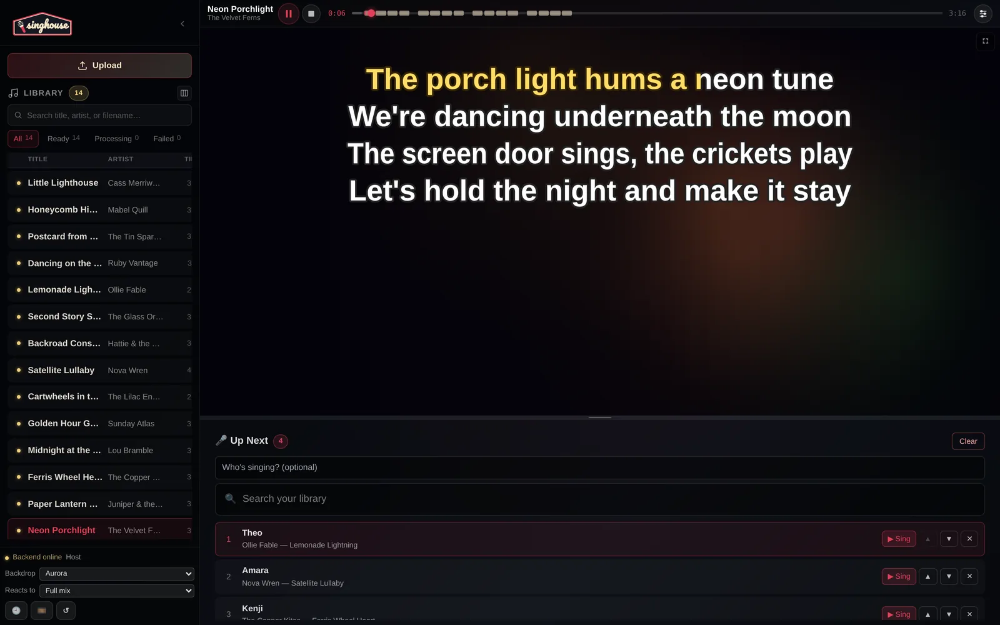

  

Self-hosted karaoke for your own music library — local stem separation (CUDA / Metal / CPU), sub-100ms word-level synced lyrics, and a web/desktop player with real-time vocal mixing, key shift, and a popout projector display.

**[Download v0.1.1](https://github.com/singhouse/singhouse/releases/tag/v0.1.1)**
· [Installation Guide](docs/install-desktop.md)
· [Architecture](PROJECT_DOCS.md)
· [How Alignment Works](lyricsync/ALIGNMENT.md)

  
   
  Shown with synthetic demo songs and singers. <a href="https://sing.house#watch">Watch the tour on sing.house</a>.

## What It Does

1. **Import tracks from your library** — FLAC, MP3, WAV, M4A, OGG, AAC, CDG, or MP3+G from disk or your [Plex server](docs/plex.md).
2. **Backing vocal stem separation** — Demucs (`mdx_extra`) splits vocals and instrumentals, then `mel_band_roformer` splits lead and backing vocals. Runs locally on your hardware or on [your own Modal account](docs/modal.md).
3. **Sub-100ms word-level sync** — Transcribes vocals with `HeartTranscriptor` (music-tuned Whisper), aligns words via phonetic Needleman-Wunsch, and refines boundaries using a 4-model CTC acoustic ensemble.
4. **Built-in timing editor & export** — Fine-tune word timings, manage multiple lyric sets per song, or export tracks as MP3+G / CD+G.
5. **Real-time mixer** — ±12 semitone key shift and live volume sliders for instrumental, backing vocals, lead vocals, and custom per-voice lanes.
6. **Stage display & host queue** — A 2D canvas lyrics renderer with a popout projector/TV window, a manual "who sings next" queue, and play history.

## Lyric Alignment Accuracy (`lyricsync`)

Singhouse's bundled [`lyricsync`](lyricsync/) library (MIT / AGPL) pairs music-tuned transcription with a **4-model CTC Viterbi aligner** (`HuBERT-Large`, `wav2vec2-Large`, `HuBERT-XLarge`, and a `wav2vec2` phoneme voter) and inter-word filler states so words never drift across instrumental breaks.

Evaluated on the 20-song Jamendo benchmark (plain reference lyrics):

| Pipeline | Median Error | Within 0.1s | Within 0.2s | Gross Error (>1s) |
| --- | ---: | ---: | ---: | ---: |
| **Singhouse (`lyricsync` CTC Fusion)** | 41 ms | 86.3% | 95.5% | 1.4% |
| Commercial cloud alignment *(AudioShake API, full mix)* | 44 ms | 85.2% | 96.2% | 1.2% |
| Single-model `wav2vec2` CTC *(Nightingale, same stem)* | 52 ms | 73.5% | 86.4% | 6.2% |
| Whisper-medium ASR + word mapping | 103 ms | 48.8% | 70.3% | 15.2% |

See **[`lyricsync/ALIGNMENT.md`](lyricsync/ALIGNMENT.md)** for full benchmarks and methodology and additional evals.

## Installation

| Platform | Download |
| --- | --- |
| Windows 11, x64 | [`.exe` installer](https://github.com/singhouse/singhouse/releases/tag/v0.1.1) |
| macOS 14+, Apple Silicon | [`.dmg` installer](https://github.com/singhouse/singhouse/releases/tag/v0.1.1) |
| Linux, x64 | [`AppImage` or archive](https://github.com/singhouse/singhouse/releases/tag/v0.1.1) |

The desktop app bundles Python and FFmpeg. Existing karaoke files (MP3+G, CDG, or pre-separated stems) play immediately without downloading AI models. To generate tracks from standard audio, open **Settings → Song processing…** (or use the first-launch wizard) to download and verify the local processing runtime and models.

## Documentation

- [Desktop installation](docs/install-desktop.md)
- [Architecture & project reference](PROJECT_DOCS.md)
- [Processing on your own Modal account](docs/modal.md)
- [Importing from your Plex server](docs/plex.md)
- [Backend development & API](backend/README.md)
- [Frontend development](frontend/README.md)
- [Building the desktop app](desktop/README.md)
- [`lyricsync` API](lyricsync/README.md) & [Alignment design](lyricsync/ALIGNMENT.md)

## Privacy

Singhouse runs locally on your machine by default. It never hosts, stores, or transmits your audio, stems, or synced lyrics, and includes no central music catalog, lyrics database, or acquisition tools.

Optional [lrclib.net](https://lrclib.net) plain-text lyrics lookup is **off by default** and sends only artist and title when enabled. Optional Modal GPU offload sends audio only to [your own Modal deployment](docs/modal.md).

## License

Licensed under **[AGPL-3.0-only](LICENSE)**. The [`lyricsync`](lyricsync/) library is additionally available under the **[MIT License](lyricsync/LICENSE)**. See [THIRD_PARTY_NOTICES.md](THIRD_PARTY_NOTICES.md), [desktop/NATIVE_NOTICES.md](desktop/NATIVE_NOTICES.md), and [CONTRIBUTING.md](CONTRIBUTING.md).
